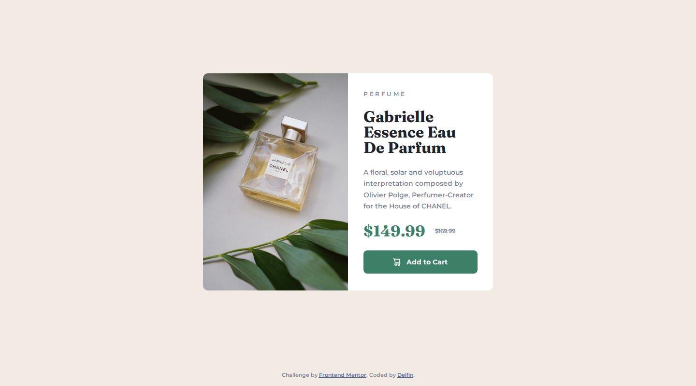
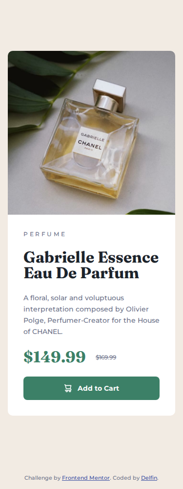

# Frontend Mentor - Product preview card component solution

This is my solution to the [Product preview card component challenge on Frontend Mentor](https://www.frontendmentor.io/challenges/product-preview-card-component-GO7UmttRfa), part of the *Building responsive layouts* learning path.

## Table of contents

- [Overview](#overview)
  - [The challenge](#the-challenge)
  - [Screenshots](#screenshots)
  - [Links](#links)
- [My process](#my-process)
  - [Built with](#built-with)
  - [What I learned](#what-i-learned)
  - [Quality checks](#quality-checks)
  - [Continued development](#continued-development)
  - [AI collaboration](#ai-collaboration)
- [Run it locally](#run-it-locally)
- [Author](#author)

## Overview

### The challenge

Users should be able to:

- View the optimal layout depending on their device's screen size
- See hover and focus states for interactive elements

### Screenshots

| Desktop (1440px) | Mobile (375px) |
| --- | --- |
|  |  |

### Links

- Solution URL: [github.com/delfinjfb/product-preview-card-component](https://github.com/delfinjfb/product-preview-card-component)
- Live Site URL: [product-preview-card-component-sooty-one.vercel.app](https://product-preview-card-component-sooty-one.vercel.app/)

## My process

### Built with

- Semantic HTML5 markup (`main`, `article`, `picture`, `del`)
- CSS custom properties for the colours and fonts from the style guide
- Flexbox
- Mobile-first workflow, with a single breakpoint at 600px
- [Montserrat](https://fonts.google.com/specimen/Montserrat) and [Fraunces](https://fonts.google.com/specimen/Fraunces) from Google Fonts

No build step, no framework, no JavaScript.

### What I learned

- **Swapping images by screen size.** The `<picture>` element with a `<source media="(min-width: 37.5rem)">` loads the mobile or the desktop image from the same markup, so only one of them is downloaded.
- **Accessible prices.** The old price uses `<del>`, and visually hidden "Current price" / "Original price" labels tell screen-reader users which number is which.
- **Keyboard focus.** The button has a `:focus-visible` outline in addition to the hover colour, so keyboard users can see where they are.

**A problem I ran into.** My first mobile version gave the image a fixed height, which cropped the perfume bottle compared with the design. I only noticed by putting a 375px screenshot next to the design JPG. The fix was to let the image keep its natural aspect ratio (`height: auto`) on mobile, and to fill the card height only on desktop. Lesson: compare against the design at each breakpoint instead of trusting the first render.

### Quality checks

After the first version I audited the page against Vercel's [Web Interface Guidelines](https://github.com/vercel-labs/web-interface-guidelines) and fixed what it found:

- **Contrast:** the footer's grey text on the cream background measured 4.03:1, below the WCAG AA minimum of 4.5:1 for small text. It now uses the near-black from the style guide (13.4:1). All other text pairs were already above 4.5:1, including the white button label on green (4.69:1).
- **Images:** `width` and `height` on the product images so the browser reserves space before they load, and `fetchpriority="high"` on the main image because it is the first thing visible.
- **Small details:** `touch-action: manipulation` on the button, no hover transition when the user prefers reduced motion, `text-wrap: balance` on the title, `translate="no"` on the product name, and a `theme-color` matching the page background.

I compared the card pixel by pixel before and after at 320, 375, 599, 600, 1000 and 1440px. Nothing moved.

### Continued development

- Self-host the two fonts and preload them, instead of loading them from Google Fonts.
- Test with a real screen reader and on physical phones. So far I only tested in headless Chromium.
- Try the layout with a CSS container query instead of a viewport breakpoint.

### AI collaboration

I used Claude Code (Claude Sonnet 5.5) to build the HTML and CSS, and to check the result in a headless browser at 1440px, 375px and 320px against the design files. I reviewed the result and published it myself.

## Run it locally

No install needed. Open `index.html` in a browser.

## Author

- GitHub - [@delfinjfb](https://github.com/delfinjfb)
